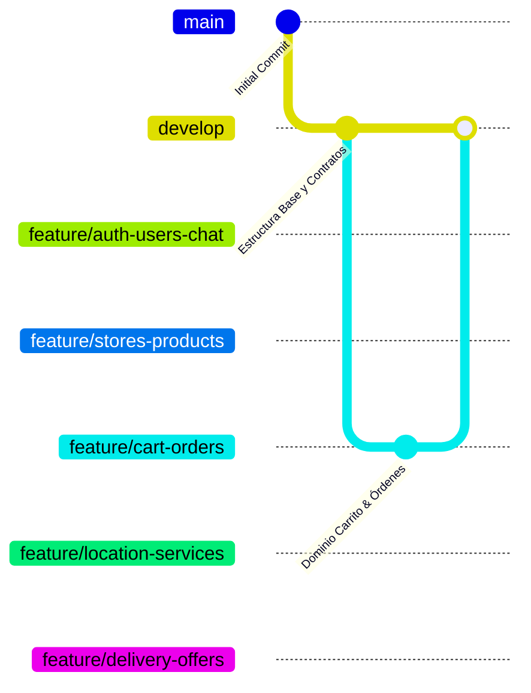

# 🍷 Bebidas Delivery App

<p align="center">
  
  
  
  
  
</p>

---

## 📌 Visión del Proyecto

**Bebidas Delivery App** es una plataforma móvil multiplataforma desarrollada en **Flutter** para Android e iOS que conecta de forma ágil y colaborativa a cuatro actores fundamentales:

* 🛒 **Clientes:** Exploración de catálogo unitienda, cálculo de precios por volumen, gestión de envases retornables y negociación de tarifas de delivery en tiempo real.
* 🏪 **Licorerías y Comercios:** Gestión de disponibilidad, horarios, confirmación/rechazo de pedidos y modalidades de entrega (delivery propio, repartidor externo o retiro en local).
* 🛵 **Repartidores:** Visualización de solicitudes de pedidos confirmados, envío de ofertas y contraofertas, tracking y confirmación de entregas.
* 🎉 **Proveedores de Eventos:** Catálogo de servicios especializados (bartenders, barras móviles, hielo, sonido y catering).

---

## 🏛️ Arquitectura del Software: Monolito Modular

El proyecto implementa un **Monolito Modular dividido por funcionalidades**, donde cada módulo tiene una separación estricta de cuatro capas:

```
presentation  ──►  application  ──►  domain  ◄──  infrastructure
   (UI/State)        (Casos de Uso)   (Reglas Puras)   (Firebase/GPS)
```

```
lib/
├── app/                                 # Orquestador global de la aplicación
│   ├── app.dart                         # MaterialApp y configuración raíz
│   ├── router/                          # Enrutamiento modular desacoplado
│   ├── theme/                           # Estilos y tokens visuales (Material 3)
│   └── dependency_injection/            # Inyector de dependencias transversal
│
├── core/                                # Elementos transversales comunes (exclusivo)
│   ├── constants/                       # Constantes del sistema
│   ├── di/                              # Contratos para inyección modular (FeatureDiModule)
│   ├── errors/                          # Failures de dominio y Excepciones de infraestructura
│   ├── result/                          # Result<S, F> con sealed classes de Dart 3
│   └── router/                          # Contratos de rutas modulares (FeatureRouteModule)
│
└── features/                            # Módulos funcionales independientes
    ├── auth/ & users/ & chat/           # 👤 Identidad, perfiles y mensajería
    ├── stores/ & products/ & pricing/   # 🏬 Comercios, catálogo y precios por volumen
    ├── returnable_containers/           # 🍾 Envases retornables
    ├── cart/ & orders/                  # 🛒 Carrito unitienda y pedidos con precios congelados
    ├── location/ & event_services/      # 🗺️ GPS, distancias Haversine y servicios de eventos
    └── delivery/ & delivery_offers/     # 🛵 Negociación, despacho y calificaciones
```

> [!IMPORTANT]
> **Regla de oro de la capa `domain`:**
> Es **Dart puro**. Está estrictamente prohibido importar Firebase, Cloud Firestore, Flutter widgets, geolocator o paquetes externos dentro de cualquier carpeta `domain/`. Todo se comunica mediante contratos e interfaces.

---

## 👥 Equipo de Desarrollo y Distribución de Módulos

El desarrollo está organizado para que cada uno de los 5 desarrolladores sea dueño de un bloque funcional completo de extremo a extremo (de la UI a los datos), minimizando dependencias cruzadas:

| Integrante | Rama de Trabajo | Módulos Asignados | Responsabilidad Principal |
|---|---|---|---|
| **Nibia** | `feature/auth-users-chat` | `auth`, `users`, `chat` | Autenticación, sesión, roles (`client`, `store`, `driver`, `eventProvider`), perfiles y chat en tiempo real. |
| **Wendy** | `feature/stores-products` | `stores`, `products`, `pricing`, `returnable_containers` | Gestión de comercios, horarios, disponibilidad de productos, precios por cantidad (**RN04**) y cálculo de envases (**RN05**). |
| **David** | `feature/cart-orders` | `cart`, `orders` | Carrito unitienda (**RN07**), creación de pedidos, precios congelados históricos (**RN08**), confirmación y ciclo de vida (**RN01**). |
| **Adriano** | `feature/location-services` | `location`, `event_services` | Coordenadas, cálculo de distancias Haversine, soporte de mapas/GPS y catálogo de proveedores para eventos. |
| **Néstor** | `feature/delivery-offers` | `delivery`, `delivery_offers`, `ratings` | Modalidades de entrega (**RN02**), negociación de tarifas, cierre atómico de ofertas (**RN06**), alternativas (**RN03**) y calificaciones. |

---

## ⚖️ Reglas de Negocio Implementadas en Dominio

* **RN01:** El comercio debe confirmar el pedido antes de que el cliente o el sistema pueda solicitar un repartidor externo.
* **RN02:** El comercio puede ofrecer entrega propia, repartidor externo o retiro en tienda.
* **RN03:** Si no hay repartidores disponibles, el cliente puede: esperar, aumentar oferta, retirar en local, usar delivery propio o cancelar.
* **RN04:** Precios escalonados según volumen/cantidad de compra.
* **RN05:** En productos retornables, **únicamente se cobra la garantía por los envases faltantes** que el cliente no entregue vacíos.
* **RN06:** Al aceptar la oferta de un repartidor, **todas las demás ofertas pendientes se cierran automáticamente**.
* **RN07:** Un pedido/carrito solo puede contener productos de un único comercio.
* **RN08:** El precio pactado en el pedido queda **congelado históricamente**, inmutable ante futuras actualizaciones del catálogo.

---

## 🚀 Flujo de Git y Prevención de Conflictos



1. **Rutas Desacopladas:** Cada desarrollador añade sus vistas en su propio `FeatureRouteModule`. Nadie edita el archivo central `app_router.dart`.
2. **Inyección Desacoplada:** Cada desarrollador registra sus servicios en su propio `FeatureDiModule`.
3. **Contratos Públicos entre Módulos:** Para consultar pedidos desde delivery, se consume `OrderDeliveryContract` en lugar de la infraestructura de `orders`.

---

## 🧪 Pruebas Unitarias y Verificación

Las pruebas del dominio se ejecutan de forma instantánea sin necesidad de emuladores ni base de datos:

```bash
# Ejecutar todas las pruebas unitarias
flutter test

# Ejecutar análisis estático de código
flutter analyze
```

### Cobertura de pruebas (Semana 2):
- ✅ `test/features/orders/order_business_rules_test.dart` (RN01, RN07, RN08)
- ✅ `test/features/products/pricing_rules_test.dart` (RN04)
- ✅ `test/features/returnable_containers/returnable_container_test.dart` (RN05)
- ✅ `test/features/delivery_offers/delivery_offers_rules_test.dart` (RN06, RN03)
- ✅ `test/features/location/haversine_distance_test.dart` (Cálculo Haversine)
- ✅ `test/features/location/obtener_ubicacion_actual_use_case_test.dart` (Permisos GPS y Ubicación Actual)
- ✅ `test/features/location/obtener_comercios_cercanos_use_case_test.dart` (Comercios ordenados por distancia)
- ✅ `test/features/location/location_map_controller_test.dart` (Estados: denegado, concedido, simulado)
- ✅ `test/features/location/mapa_proximo_page_widget_test.dart` (Visualización de mapa, marcadores y denegación de permisos)
- ✅ `test/widget_test.dart` (Smoke test de arranque de la app)

---

## 💻 Puesta en Marcha Local

```bash
# 1. Clonar el repositorio
git clone https://github.com/NestorAyala123/bebidas-delivery-app.git

# 2. Instalar dependencias
flutter pub get

# 3. Correr la aplicación
flutter run
```
